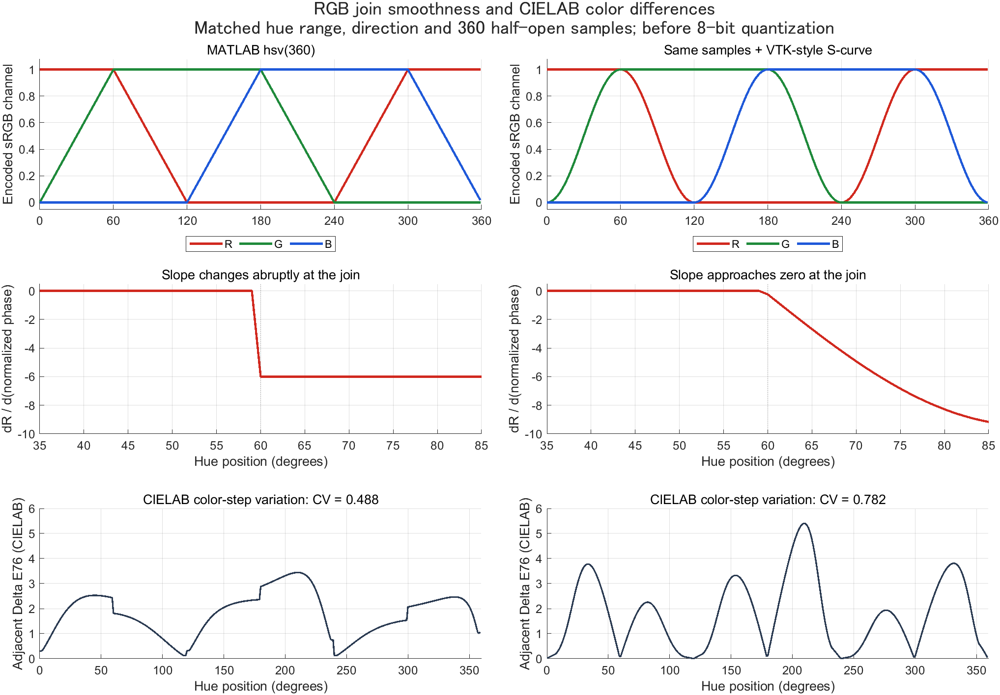
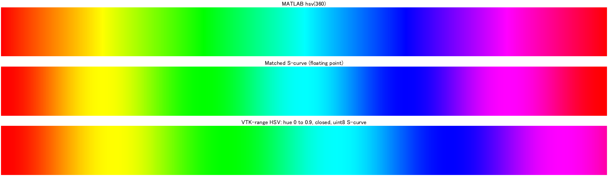
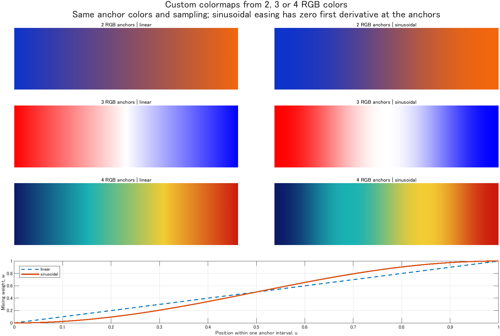
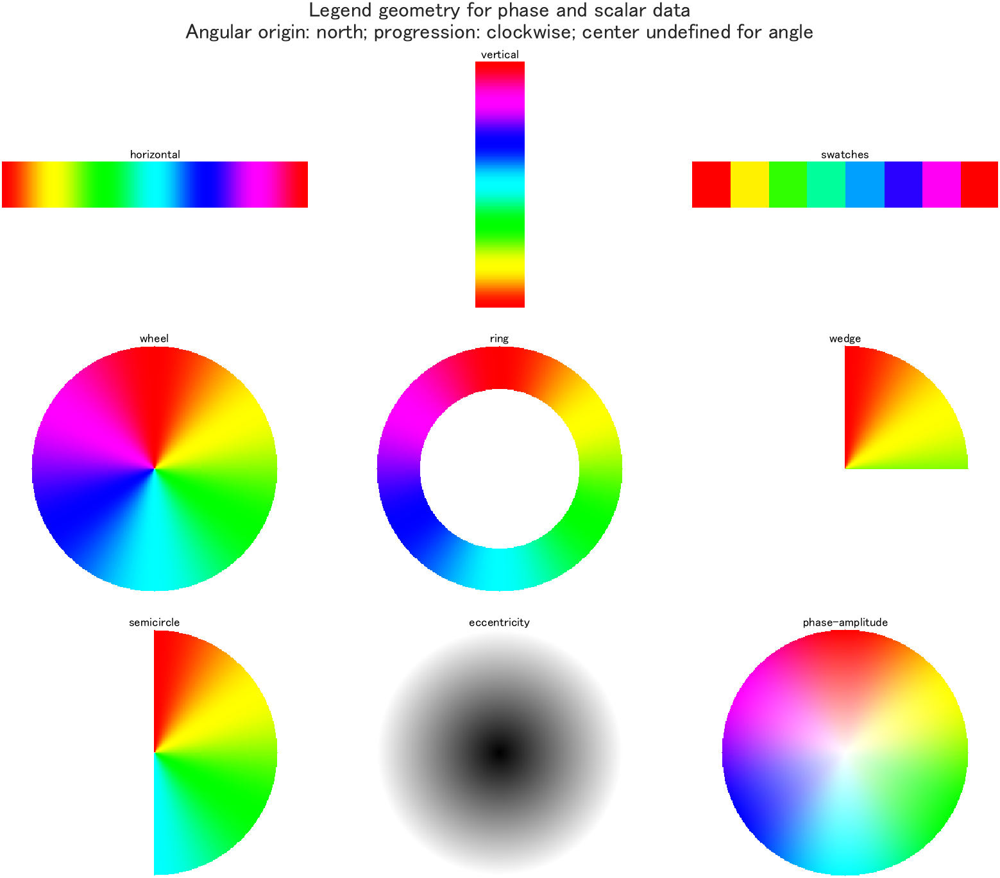

# README on ColormapTools

[日本語](README_ja.md)

Created: "2026-11-10 01:42:11 ban"
Last Update: "2026-11-10 01:42:32 ban"

ColormapTools provides MATLAB functions for generating, comparing and sharing colormaps with explicit RGB transition rules. The package addresses software-dependent HSV definitions and provides additional tools for custom RGB palettes and multiple legend formats.

The package has three main parts:

1. **RGB generation and interpolation** — functions for MATLAB-HSV and VTK-formula palettes, arbitrary LUTs, and selectable linear or sinusoidal transitions.
2. **Flexible display functions** — tools for displaying a colormap as a bar, wheel, ring or another supported legend.
3. **Ready-to-use sample palettes** — anchor-based examples such as RWB, OWP and CWM beyond MATLAB's built-in palette names.

---

<a id="menu"></a>
## Menu

- [Introduction — why color rules matter](#introduction)
- [System requirements](#requirements)
- [Tools for colormap generation and sharing](#usage)
- [Included sample colormaps](#sample-maps)
- [Custom RGB colormap generation](#custom-rgb)
- [Tools for displaying colormaps in different formats](#display)
- [License](#license)
- [Citation](#citation)
- [References](#references)

---

<a id="introduction"></a>
## Introduction — why color rules matter

A colormap name alone does not fully specify the colors used to display data. Two applications may both use an HSV-based palette while assigning different RGB values to the same data value. A common hue order is not enough: the transition rule, hue range, direction, number of colors and endpoint sampling also need to agree.

One concrete example is MATLAB HSV and the S-curve ramp used by VTK's `vtkLookupTable`:

- In MATLAB R2023b, `hsv(n)` samples a full HSV hue cycle with saturation S=1 and value V=1. As hue advances, the encoded RGB channels follow piecewise-linear segments, so their slopes change at the joins.
- In VTK 9.5.2, `vtkLookupTable` uses an **S-curve ramp by default** when generating a table from HSV ranges. Each RGB component is transformed by a sinusoidal curve that flattens at 0 and 1. This changes how quickly the RGB values progress through each hue interval.

The same numerical field can therefore produce different RGB images and different widths of slowly and rapidly changing color bands. ColormapTools provides functions to reproduce these choices in MATLAB, compare their RGB transitions, and export the resulting lookup tables for sharing across software. The definitions are documented in [MathWorks HSV](https://www.mathworks.com/help/matlab/ref/hsv.html) and the [versioned VTK implementation](https://raw.githubusercontent.com/Kitware/VTK/v9.5.2/Common/Core/vtkLookupTable.cxx).

The comparison below concerns MATLAB `hsv` and VTK 9.5.2 `vtkLookupTable`. The VTK constructor also uses hue range `[0,0.66667]` and closed endpoint sampling, so comparing unmodified defaults would mix several differences. To examine the component S-curve, the first figure holds the hue range, direction and 360 half-open sample positions fixed. Other MATLAB palettes and VTK-based rendering components have their own definitions.

### Inspecting the difference

The top row shows RGB values. The middle row enlarges the red-channel slope near a join: the S-curve removes the abrupt slope change before quantization. The bottom row adds a separate diagnostic: **estimated color differences between neighboring entries, assuming sRGB and a D65 reference white**.



The lower curve is ΔE76, the distance between neighboring colors in CIELAB. It is computed for all 360 adjacent pairs, including the last-to-first pair. **CV** is their population standard deviation divided by their mean. Here CV is about **0.488 for MATLAB HSV** and **0.782 for the matched S-curve**. The RGB joins become smoother, while the CIELAB step sizes become more variable. This comparison makes the trade-off visible; it does not establish that either rule is universally easier to read.

The strips below show the resulting colors. The first two use the matched settings above. The third demonstrates a separate VTK-formula preset with hue range `[0,0.9]`, closed sampling and byte quantization. That preset is named `vtk-hsv` in this package; `[0,0.9]` is not the VTK constructor's default range.



RGB-to-CIELAB conversion here assumes standard sRGB characteristics, rather than measured output from a particular display. CIELAB color distance is also only an approximation to perceived difference. See the [CIE explanation](https://www.cie.co.at/publications/colorimetry-part-6-ciede2000-colour-difference-formula-1) and the [calculation, assumptions and limits](docs/COLOR_DIFFERENCE.md#english).

### Tools for generation, sharing and display

The package provides functions for selecting an RGB rule, generating or importing a table, and exporting it with source notes. Matching color tables and data-to-color normalization addresses differences at the lookup-table level; display calibration, lighting, alpha blending and other rendering settings still need to be controlled separately.

Additional functions create a palette from two to four chosen RGB colors and display its legend in several forms. The supplied sample palettes use the same generation functions. The following sections introduce the tools and examples for each capability.

[back to the menu](#menu)

<a id="requirements"></a>
## System requirements

- MATLAB environment: Windows, MATLAB R2023b Update 11.
- Generation, legend rendering and diagnostics use standard MATLAB; Image Processing Toolbox is not required. Hashing uses MATLAB's JVM.
- No Python installation, external reference collection or network connection is required to use the package.

[back to the menu](#menu)

<a id="usage"></a>
## Tools for colormap generation and sharing

`generate_colormap` provides MATLAB-HSV-compatible generation, VTK-formula presets, and interpolation of supplied RGB tables. The `hsv` preset follows MATLAB's HSV sampling; `hsv-scurve` applies the component S-curve at matching sample positions. Color count, direction and quantization are explicit options.

The example below generates both HSV variants. Run it from the package root in MATLAB:

```matlab
addpath('src');
matlabHSV = generate_colormap('hsv',360);
smoothHSV = generate_colormap('hsv-scurve',360);
imagesc(peaks(200)); colormap(smoothHSV); colorbar;
```

`export_colormap` provides CSV export with a JSON description and checksum. Together with the VTK-formula presets, it supports sharing an explicit RGB table across applications:

```matlab
vtkLUT = generate_colormap('vtk-hsv',361,'Quantize',true);
export_colormap('shared-lut.csv',vtkLUT, ...
    'Source','VTK v9.5.2 vtkLookupTable formula', ...
    'Notes','HueRange=[0,0.9]; closed sampling; S-curve; Quantize=true');
```

The export contains normalized RGB rows and JSON with the row count, color-space description, supplied source notes and checksum. The table can be imported into another application. Matching scalar limits, lookup rules and rendering conditions is also necessary for matching rendered results; see the [mapping and export conventions](docs/API.md).

The following functions cover generation, mapping, display and diagnostics:

| Function | Main use |
| --- | --- |
| `generate_colormap_from_rgb` | Build a 2–4-color map with selectable linear (default) or sinusoidal/S-curve interpolation |
| `generate_colormap` | Named samples, arbitrary LUTs/CSVs, analytic HSV/VTK presets |
| `generate_phase_colormap` | Explicit cyclic sampling, phase origin, direction and cycles |
| `colormap_legend` | Return a legend image, alpha and metadata without opening a figure |
| `show_colormap` | Display a legend with axes and labels |
| `apply_colormap` | Map numeric scalar fields to truecolor RGB |
| `analyze_colormap` | RGB, CIELAB and color-vision-deficiency screening diagnostics |
| `export_colormap` | Save LUT CSV and metadata with a checksum |

For detailed inputs, outputs and conventions, see each function's header and the [API reference](docs/API.md). Executable examples are in `examples/`.

[back to the menu](#menu)

<a id="sample-maps"></a>
## Included sample colormaps

The package includes `rwb`, `owp`, `cwm` and other sample colormaps whose names are not built into MATLAB. They are supplied as small RGB anchor tables that can be used directly with `generate_colormap`. Each sample supports a chosen interpolation method and output length.

| Name | RGB anchor order |
| --- | --- |
| `rwb` / `rwg` | red → white → blue / green |
| `owp` / `op` | orange → white → purple / orange → purple |
| `bwy` / `cwm` / `gwp` | blue → white → yellow / cyan → white → magenta / green → white → purple |
| `by` / `cm` / `rg` | blue → yellow / cyan → magenta / red → green |

```matlab
rwb = generate_colormap('rwb',257,'Method','cosine');
owp = generate_colormap('owp',257,'Method','cosine');
hsvSmooth = generate_colormap('hsv-scurve',360);
vtkHSV = generate_colormap('vtk-hsv',361,'Quantize',true);
```

Named anchors are stored in `data/anchors/`. `hsv-scurve` provides matched MATLAB-HSV sampling with a component S-curve; `vtk-hsv` and `vtk-rygb` implement specified `vtkLookupTable` hue ranges and quantization. A shared LUT helps control cross-software choices, while lighting, normalization and color management still need matching in the consuming renderer.

[back to the menu](#menu)

<a id="custom-rgb"></a>
## Custom RGB colormap generation

`generate_colormap_from_rgb` provides a tool for connecting any two to four RGB colors into a colormap. It accepts one normalized RGB color per row in a 2×3, 3×3 or 4×3 array and supports both ramp choices below.

| `Method` | RGB transition |
| --- | --- |
| `'linear'` **(default)** | Linear interpolation within each anchor interval |
| `'sinusoidal'` | S-curve interpolation with zero slope at the interval endpoints before quantization |

The same anchors can be passed to either method:

```matlab
% Method selects the ramp: linear (default) or sinusoidal (S-curve).
% One RGB color per row; values are in [0,1].
anchors = [1 0 0; 1 1 1; 0 0 1];
cmapLinear = generate_colormap_from_rgb(anchors,257,'Method','linear');
cmapSCurve = generate_colormap_from_rgb(anchors,257,'Method','sinusoidal');
imagesc(peaks(200)); colormap(cmapSCurve); colorbar;

% Four colors and any desired output length.
anchors4 = [.05 .1 .4; .1 .7 .7; .95 .8 .2; .8 .1 .05];
cmap4 = generate_colormap_from_rgb(anchors4,601,'Method','sinusoidal');

% Explicitly normalize byte RGB; no automatic range guessing.
byteRGB = [255 0 0; 255 255 255; 0 0 255];
cmap = generate_colormap_from_rgb(double(byteRGB)/255,257);
```



`Method='sinusoidal'` uses `w=(1-cos(pi*u))/2` within each anchor interval; `cosine` is an alias. The sinusoidal form has zero first derivative at the anchors before quantization. Interpolation is in display-encoded sRGB, and does not impose equal perceptual color differences.

`n` defaults to 256 and specifies the exact number of output rows. For `n>=2`, an open map includes both endpoints. `n=0` returns an empty 0×3 LUT; `n=1` returns the first anchor. Interior anchors appear exactly when the sampling grid includes their positions, as with the 257-row three-color example above.

`Positions`, `Reverse` and `Quantize` follow the core API. For an unequally spaced middle color:

```matlab
[cmap,info] = generate_colormap_from_rgb(anchors,501, ...
    'Method','sinusoidal','Positions',[0 .2 1]);
info.AnchorRGB
info.AnchorPositions
```

This helper builds open paths. Use `generate_colormap` or `generate_phase_colormap` for cyclic paths. For a small comparison, run `addpath('examples'); demo_rgb_colormaps;`.

[back to the menu](#menu)

<a id="display"></a>
## Tools for displaying colormaps in different formats

The package also provides tools for displaying a colormap legend in different formats. `show_colormap` displays the legend with optional axes and labels; `colormap_legend` returns its RGB image, transparency and metadata without opening a window. These functions accept generated or supplied RGB tables.

The available geometries include bars for scalar values, wheels and rings for direction or phase, and radial disks for distance from a center.

Supported formats are horizontal and vertical bars, discrete swatches, wheels, rings, wedges, semicircles, eccentricity disks and phase–amplitude disks.



```matlab
phase = generate_phase_colormap('hsv-scurve',360);
show_colormap(phase,'ring','OriginDegrees',0, ...
    'Direction','counterclockwise','Limits',[0 360], ...
    'TickValues',[0 90 180 270]);

[rgb,alpha,meta] = colormap_legend(phase,'wheel', ...
    'OriginDegrees',0,'Direction','counterclockwise','Size',601);
imwrite(rgb,'phase-key.png','Alpha',alpha);
```

The display functions provide options for angular orientation, lookup, limits and transparency. The default generic angular legend starts at the top and runs clockwise; the example above explicitly uses right-zero and counterclockwise progression. [Legend and coordinate details](docs/API.md).

[back to the menu](#menu)

<a id="license"></a>
## License

The code is distributed under the [BSD 2-Clause License](LICENSE). Mathematical references and external numerical reference values are credited in [THIRD_PARTY_NOTICES.md](THIRD_PARTY_NOTICES.md).

[back to the menu](#menu)

<a id="citation"></a>
## Citation

If the package helps your work, please cite the software version or commit you used, following [CITATION.cff](CITATION.cff). Also cite any original palette or method on which your analysis relies.

[back to the menu](#menu)

<a id="references"></a>
## References

1. [MathWorks: colormap and normalized RGB tables](https://www.mathworks.com/help/matlab/ref/colormap.html).
2. [MathWorks: hsv](https://www.mathworks.com/help/matlab/ref/hsv.html).
3. [VTK v9.5.2 vtkLookupTable source](https://github.com/Kitware/VTK/blob/v9.5.2/Common/Core/vtkLookupTable.cxx).
4. Machado, Oliveira & Fernandes (2009), [10.1109/TVCG.2009.113](https://doi.org/10.1109/TVCG.2009.113).

[back to the menu](#menu)

