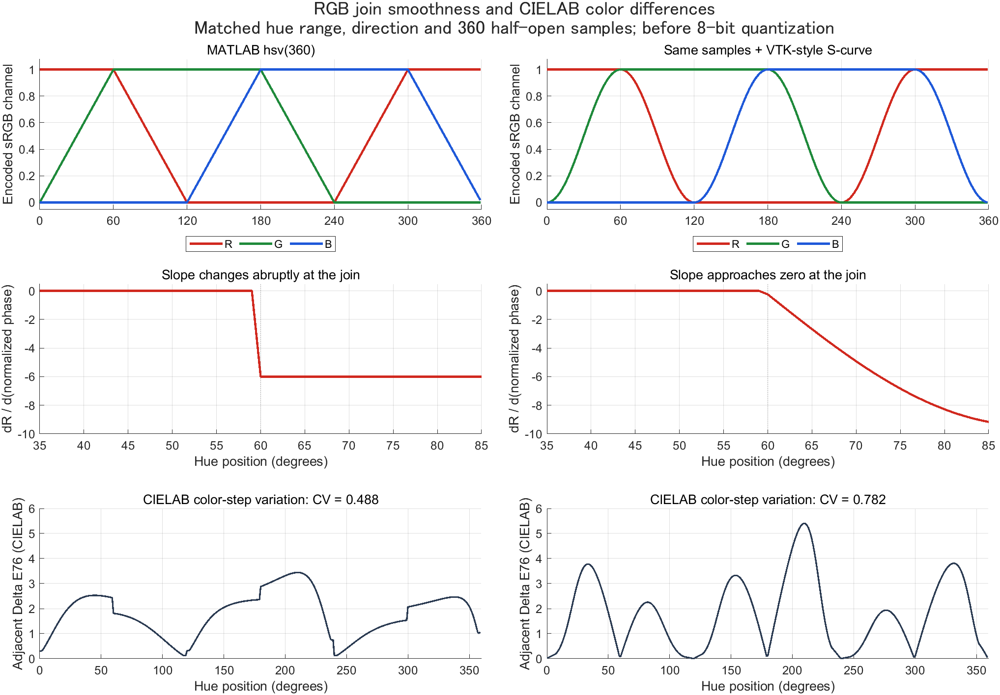
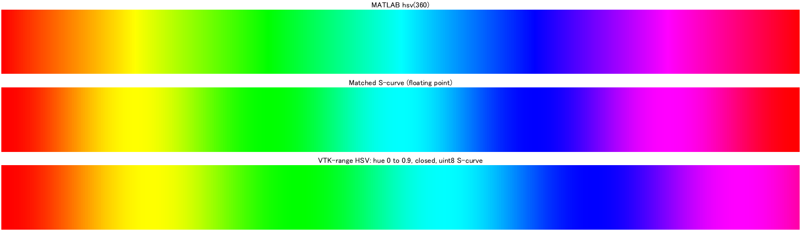
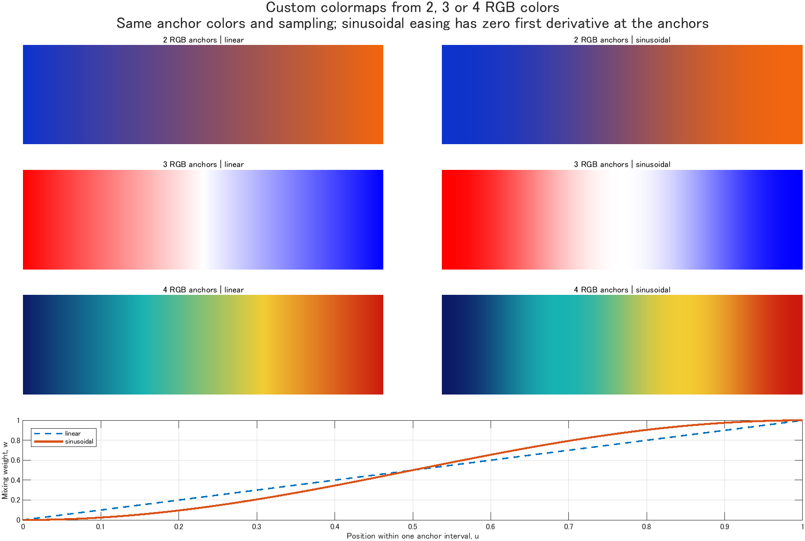
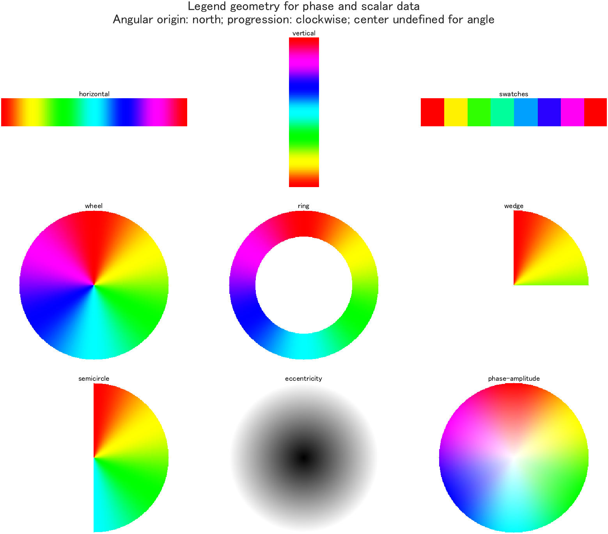

# README on ColormapTools

[English](README.md)

Created: "2026-11-10 01:42:11 ban"
Last Update: "2026-11-10 01:42:30 ban"

<p align="center">
    <a href="LICENSE"></a><br>
  <br>
   
</p>

ColormapToolsは、ソフトウェア間で異なるカラーマップの定義に対処するため、RGBの遷移規則を明示した生成・比較・保存の関数群を提供するMATLABパッケージです。任意のRGBから配色を作る関数と、凡例を様々な形式で表示する関数も含みます。

主な機能は次の三つです。

1. **RGBの生成・補間** — MATLAB HSVやVTKの式による配色、任意のLUT、線形・sinusoidal遷移に対応する生成関数を提供します。
2. **様々な形式での表示** — カラーマップの凡例をバー、Wheel、Ringなどで表示する関数を提供します。
3. **すぐ使えるサンプル配色** — MATLAB標準の配色名にはないRWB、OWP、CWMなどのアンカー例を同梱しています。

---

<a id="menu"></a>
## Menu 目次

- [Introduction — 色の定義を明示する理由](#introduction)
- [動作環境](#requirements)
- [カラーマップの再現・共有ツール](#usage)
- [同梱するサンプル配色](#sample-maps)
- [任意RGBからのカラーマップ生成ツール](#custom-rgb)
- [カラーマップを様々な形式で表示するツール](#display)
- [ライセンス](#license)
- [引用](#citation)
- [参考文献](#references)

---

<a id="introduction"></a>
## Introduction — 色の定義を明示する理由

カラーマップは、名前が同じでもソフトウェア間で同じRGB値になるとは限りません。どちらもHSVに基づく配色であっても、同じデータ値に割り当てる色が異なることがあります。色相の順序に加え、RGBの遷移規則、色相範囲、向き、色数、端点の標本化まで揃える必要があります。

具体例が、MATLABのHSVと、VTKの`vtkLookupTable`で使われるS-curveです。

- MATLAB R2023bの`hsv(n)`は、HSVの彩度S=1・値V=1に固定して色相周期を標本化します。色相に沿ったRGBチャンネルの変化は区分線形で、各区間の接続部では傾きが切り替わります。
- VTK 9.5.2の`vtkLookupTable`は、HSV範囲から色表を生成する際の**既定のRampがS-curve**です。各RGB成分にsinusoidalな変換を適用し、0と1の端点付近で変化が緩やかになるようにします。そのため、色相区間内でRGB値が進む速さが変わります。

この違いにより、同じ数値場でもRGB画像や、色がゆっくり変化する帯・速く変化する帯の幅が変わります。ColormapToolsでは、こうした規則をMATLAB上で再現し、RGBの遷移を比較して、実際の色表をソフト間で共有するための関数群を提供します。参照元は[MathWorksのHSV資料](https://www.mathworks.com/help/matlab/ref/hsv.html)と[版付きVTK実装](https://raw.githubusercontent.com/Kitware/VTK/v9.5.2/Common/Core/vtkLookupTable.cxx)です。

以下は、MATLABの`hsv`とVTK 9.5.2の`vtkLookupTable`を対象にした比較です。VTKのコンストラクターの既定値には、色相範囲`[0,0.66667]`と両端を含む標本化もあるため、既定値同士では複数の違いが混在します。そこで最初の図では、色相範囲・向き・360個の半開区間の標本点を揃え、component S-curveの効果を比較しています。他のMATLAB配色やVTKを使う描画部品には、それぞれの定義があります。

### 実際の違いを確認する

上段はRGB値、中段は接続部付近の赤チャンネルの傾きです。S-curveでは量子化前の傾きの急な切り替わりが滑らかになります。下段は別の性質を確認するための診断で、**sRGBとD65基準白色を仮定した、隣接色の色差推定値**を示します。



下段のΔE76は、CIELAB上で隣り合う色の距離です。末尾から先頭への接続を含む360組について計算しています。**CV（変動係数）**は、その色差の母標準偏差を平均で割った値です。この例では**MATLAB HSVが約0.488、対応するS-curveが約0.782**で、RGBの接続は滑らかになってもCIELAB色差のばらつきは増えます。こうした性質の違いを確認するための比較であり、どちらの規則が常に読み取りやすいかを実証したものではありません。

次の色帯では、上の2本が同じ条件での比較です。3本目は別の例として、色相範囲`[0,0.9]`・両端を含む標本化・バイト量子化を使うVTKの式による配色を示します。本パッケージではこれを`vtk-hsv`と呼びます。`[0,0.9]`はVTKコンストラクターの既定範囲ではありません。



ここでのRGBからCIELABへの変換は、特定の装置の実測ではなく、標準sRGBの特性を仮定しています。また、CIELAB上の距離による知覚差の表現自体も近似です。[CIEの解説](https://www.cie.co.at/publications/colorimetry-part-6-ciede2000-colour-difference-formula-1)と[計算方法・前提・限界](docs/COLOR_DIFFERENCE.md#japanese)に詳細を記載しています。

### 生成・保存・表示のための関数群

本パッケージには、RGBの規則を指定した生成、色表の読み込み、出典の注記を伴う保存に対応する関数を用意しています。同じ色表と数値から色への対応を共有することで、LUTの段階でのソフト間の違いに対処します。表示装置の較正、照明、透明度の合成などの描画条件は、別途揃える必要があります。

さらに、任意の2～4色をつないで配色を作る関数と、その凡例を様々な形で表示する関数を提供します。同梱のサンプル配色も、共通の生成関数で扱えます。以下に、それぞれの機能と使用例を示します。

[目次へ戻る](#menu)

<a id="requirements"></a>
## 動作環境

- MATLAB環境：Windows、MATLAB R2023b Update 11。
- 生成・凡例表示・診断は標準MATLABで動作します。Image Processing Toolboxは不要です。ハッシュ計算にはMATLABのJVMを使います。
- 利用にPython、外部の参照ツール集、ネット接続は必要ありません。

[目次へ戻る](#menu)

<a id="usage"></a>
## カラーマップの再現・共有ツール

`generate_colormap`は、MATLAB HSVに対応する配色、VTKの式に基づくプリセット、任意のRGB表からの補間に対応する生成関数です。`hsv`はMATLAB HSVの標本化に従い、`hsv-scurve`は対応する標本点でcomponent S-curveを適用します。色数、向き、量子化も指定できます。

以下は両方のHSVを生成する例です。MATLABでパッケージのルートフォルダーを開いて実行できます。

```matlab
addpath('src');
matlabHSV = generate_colormap('hsv',360);
smoothHSV = generate_colormap('hsv-scurve',360);
imagesc(peaks(200)); colormap(smoothHSV); colorbar;
```

`export_colormap`は、生成したRGB表をCSVとJSONに保存する関数です。VTKの式によるプリセットと組み合わせ、実際の色表を別のソフトへ渡す用途に利用できます。

```matlab
vtkLUT = generate_colormap('vtk-hsv',361,'Quantize',true);
export_colormap('shared-lut.csv',vtkLUT, ...
    'Source','VTK v9.5.2 vtkLookupTable formula', ...
    'Notes','HueRange=[0,0.9]; closed sampling; S-curve; Quantize=true');
```

出力は正規化RGBのCSVと、行数・色空間の表記・指定した出典と注記・ハッシュを含むJSONです。保存した色表は別のソフトへ読み込めます。描画結果を一致させるには、数値範囲・色の参照規則・描画条件も揃える必要があります。詳細は[数値と色の対応・保存の規則](docs/API.md)に記載しています。

生成、数値から色への変換、表示、診断を、次の関数で扱います。

| 関数 | 主な用途 |
| --- | --- |
| `generate_colormap_from_rgb` | 2～4色から生成し、linear（既定）／sinusoidal（S-curve）を選択 |
| `generate_colormap` | 名前付きサンプル、任意LUT/CSV、HSV/VTKの式による生成 |
| `generate_phase_colormap` | 循環標本化、位相原点、方向、周期数の指定 |
| `colormap_legend` | ウィンドウを開かず凡例画像・alpha・メタデータを返す |
| `show_colormap` | 凡例を軸・ラベルとともに表示 |
| `apply_colormap` | 数値場をtruecolor RGBへ変換 |
| `analyze_colormap` | RGB・CIELAB・色覚シミュレーションによる診断 |
| `export_colormap` | LUTのCSVとハッシュ付きメタデータを保存 |

入出力と規則の詳細は各関数のヘッダーと[API資料](docs/API.md)、実行例は`examples/`を参照してください。

[目次へ戻る](#menu)

<a id="sample-maps"></a>
## 同梱するサンプル配色

MATLAB標準の配色名にはない`rwb`、`owp`、`cwm`などを、サンプルカラーマップとして同梱しています。いずれも小さなRGBアンカー表で、`generate_colormap`に名前を渡して利用できます。各サンプルに対して補間方法と出力行数を指定できます。

| 名前 | RGBアンカーの順序 |
| --- | --- |
| `rwb` / `rwg` | 赤 → 白 → 青 / 緑 |
| `owp` / `op` | オレンジ → 白 → 紫 / オレンジ → 紫 |
| `bwy` / `cwm` / `gwp` | 青 → 白 → 黄 / シアン → 白 → マゼンタ / 緑 → 白 → 紫 |
| `by` / `cm` / `rg` | 青 → 黄 / シアン → マゼンタ / 赤 → 緑 |

```matlab
rwb = generate_colormap('rwb',257,'Method','cosine');
owp = generate_colormap('owp',257,'Method','cosine');
hsvSmooth = generate_colormap('hsv-scurve',360);
vtkHSV = generate_colormap('vtk-hsv',361,'Quantize',true);
```

アンカーは`data/anchors/`に保存されています。`hsv-scurve`はMATLAB HSVと標本点を揃えたcomponent S-curve、`vtk-hsv`と`vtk-rygb`は指定した`vtkLookupTable`の色相範囲と量子化を実装します。共通LUTによりソフト間の選択を揃えられますが、利用先の照明・正規化・色管理も一致させる必要があります。

[目次へ戻る](#menu)

<a id="custom-rgb"></a>
## 任意RGBからのカラーマップ生成ツール

任意の2～4色のRGBをつないでカラーマップを作成するために、`generate_colormap_from_rgb`を用意しています。入力は、一行を一色の正規化RGBとする2×3、3×3、4×3の配列です。rampには、`Method`で次の2方式を指定できます。

| `Method` | RGBの遷移 |
| --- | --- |
| `'linear'` **（既定値）** | 各アンカー区間を線形に補間 |
| `'sinusoidal'` | 量子化前の区間端点で傾きが0になるS-curveで補間 |

以下は、同じRGBから両方式で生成する例です。

```matlab
% Method selects the ramp: linear (default) or sinusoidal (S-curve).
% One RGB color per row; values are in [0,1].
anchors = [1 0 0; 1 1 1; 0 0 1];
cmapLinear = generate_colormap_from_rgb(anchors,257,'Method','linear');
cmapSCurve = generate_colormap_from_rgb(anchors,257,'Method','sinusoidal');
imagesc(peaks(200)); colormap(cmapSCurve); colorbar;

% Four colors and any desired output length.
anchors4 = [.05 .1 .4; .1 .7 .7; .95 .8 .2; .8 .1 .05];
cmap4 = generate_colormap_from_rgb(anchors4,601,'Method','sinusoidal');

% Explicitly normalize byte RGB; no automatic range guessing.
byteRGB = [255 0 0; 255 255 255; 0 0 255];
cmap = generate_colormap_from_rgb(double(byteRGB)/255,257);
```



`Method='sinusoidal'`では、各アンカー区間で`w=(1-cos(pi*u))/2`を使います。`cosine`も同じ指定として受け付けます。sinusoidalでは量子化前のアンカー位置で一次微分が0になります。表示符号化されたsRGB上での補間であり、知覚的色差を均等にする処理ではありません。

`n`の既定は256で、出力行数を正確に指定します。`n>=2`の開いたマップは両端点を含みます。`n=0`は0×3、`n=1`は先頭色を返します。中間アンカーが厳密に現れるのは標本点がその位置を含む場合です。上の3色・257行の例では中間色も含まれます。

`Positions`、`Reverse`、`Quantize`は基本APIに合わせています。中間色の位置を変える例です。

```matlab
[cmap,info] = generate_colormap_from_rgb(anchors,501, ...
    'Method','sinusoidal','Positions',[0 .2 1]);
info.AnchorRGB
info.AnchorPositions
```

この関数は開いた色経路用です。循環する経路には`generate_colormap`または`generate_phase_colormap`を使います。小さな比較例は`addpath('examples'); demo_rgb_colormaps;`で実行できます。

[目次へ戻る](#menu)

<a id="display"></a>
## カラーマップを様々な形式で表示するツール

作成したカラーマップの凡例を、様々な形式で表示するツールも用意しています。`show_colormap`は軸やラベルを付けて凡例を表示する関数、`colormap_legend`はウィンドウを開かずRGB画像・透過情報・メタデータを返す関数です。生成した色表と、外部から用意したRGB表のどちらも入力できます。

一般のスカラー量を示すバー、方向や位相を示すWheelやRing、中心からの距離を示す放射状のディスクなどを表示できます。

対応する形式は、水平・垂直バー、離散色見本、Wheel、Ring、扇形、半円、偏心度ディスク、位相と振幅のディスクです。



```matlab
phase = generate_phase_colormap('hsv-scurve',360);
show_colormap(phase,'ring','OriginDegrees',0, ...
    'Direction','counterclockwise','Limits',[0 360], ...
    'TickValues',[0 90 180 270]);

[rgb,alpha,meta] = colormap_legend(phase,'wheel', ...
    'OriginDegrees',0,'Direction','counterclockwise','Size',601);
imwrite(rgb,'phase-key.png','Alpha',alpha);
```

表示関数のオプションとして、向き、参照規則、範囲、透明領域を指定できます。汎用角度凡例の既定は上始まり・時計回りで、上の例は右0度・反時計回りを明示しています。[凡例と座標の詳細](docs/API.md)を参照してください。

[目次へ戻る](#menu)

<a id="license"></a>
## ライセンス

コードは[BSD 2条項ライセンス](LICENSE)で配布します。数学的な参照元と外部の数値参照値の出典は[THIRD_PARTY_NOTICES.md](THIRD_PARTY_NOTICES.md)に記載しています。

[目次へ戻る](#menu)

<a id="citation"></a>
## 引用

研究に利用する場合は、[CITATION.cff](CITATION.cff)に従い、使用した版またはcommitを明記してください。解析に利用した元の配色や手法も引用してください。

[目次へ戻る](#menu)

<a id="references"></a>
## 参考文献

1. [MathWorks：colormapと正規化RGB表](https://www.mathworks.com/help/matlab/ref/colormap.html)。
2. [MathWorks：hsv](https://www.mathworks.com/help/matlab/ref/hsv.html)。
3. [VTK v9.5.2 vtkLookupTableのソース](https://github.com/Kitware/VTK/blob/v9.5.2/Common/Core/vtkLookupTable.cxx)。
4. Machado, Oliveira & Fernandes (2009), [10.1109/TVCG.2009.113](https://doi.org/10.1109/TVCG.2009.113)。

[目次へ戻る](#menu)

